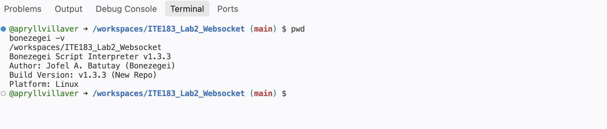
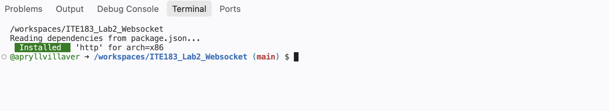
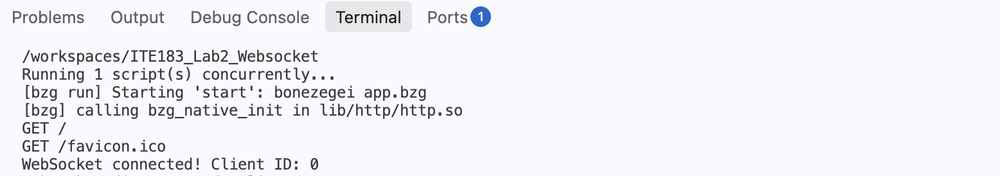
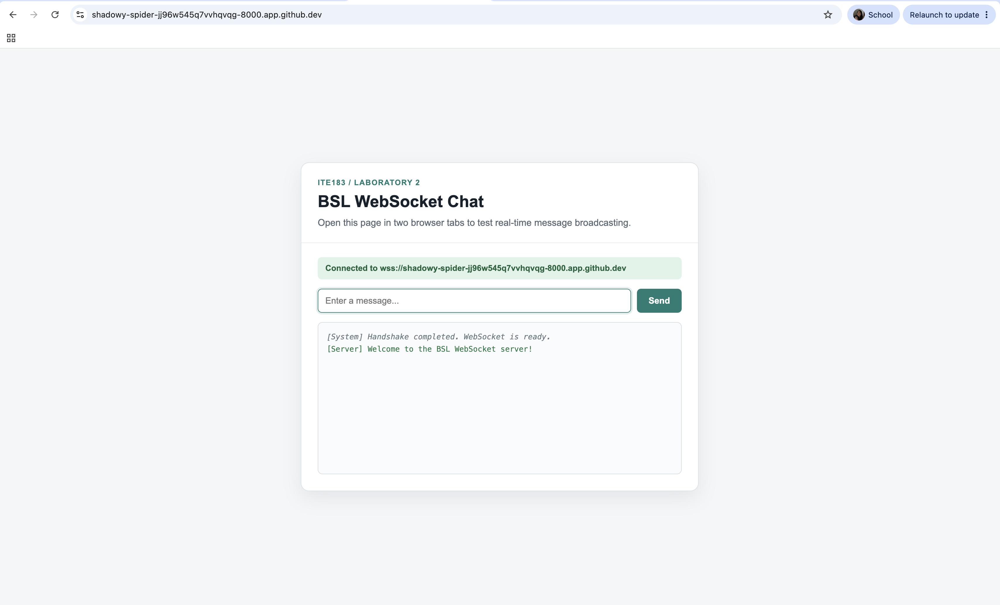
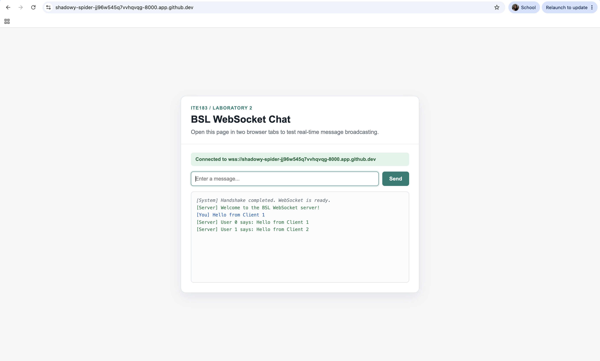
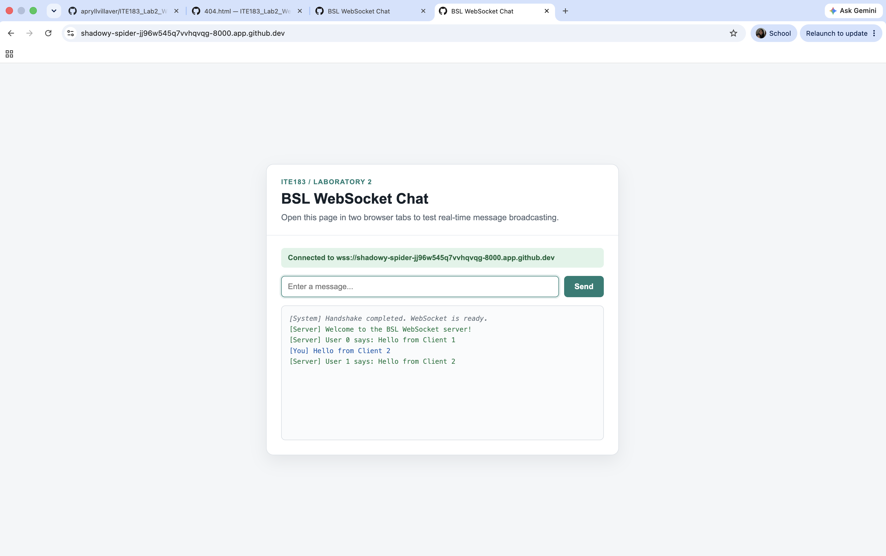
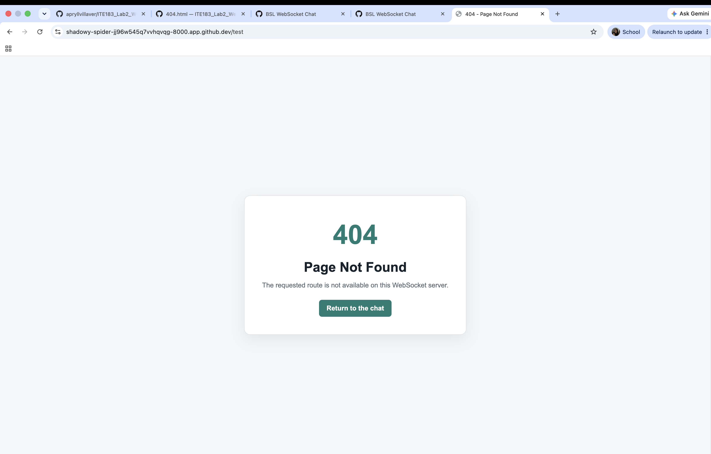

# BSL WebSocket Chat Server

> ITE183 Laboratory Activity 2: Building a WebSocket Server

This project is a browser-based chat application built with the Bonezegei Scripting Language and its HTTP library. It demonstrates how a server can keep multiple browser clients connected and distribute a message to all active connections in real time.

Unlike the usual HTTP request-and-response process, the WebSocket connection remains open after the initial handshake. This allows the browser and server to continue exchanging messages without creating a new HTTP request for every update.

## 📌 What the Project Demonstrates

The application provides the following behavior:

- Serves the chat interface from the `/` route.
- Opens a persistent WebSocket connection for each browser client.
- Assigns and records a client identifier when a connection is established.
- Sends a welcome message to a newly connected client.
- Receives messages from one client and broadcasts them to every connected client.
- Records client disconnections in the server terminal.
- Displays a custom page for unsupported HTTP routes.
- Runs on port `8000`.

## 📁 Project Structure

```text
ITE183_Lab2_Websocket/
├── .gitattributes
├── LICENSE
├── README.md
├── app.bzg
├── package.json
├── documentation/
│   ├── version_check.png
│   ├── dependency_install.png
│   ├── server_running.png
│   ├── client_connected.png
│   ├── broadcast_client1.png
│   ├── broadcast_client2.png
│   └── custom_404.png
├── lib/
│   ├── http.bzg
│   ├── http.json
│   └── http/
│       └── http.so
└── public/
    ├── index.html
    └── 404.html
```

The `lib/` directory is generated by the Bonezegei package manager when the HTTP dependency is installed. Its exact native files may vary according to the operating system and processor architecture.

## 🧰 Requirements

This implementation was prepared and tested with:

- Bonezegei Scripting Language `1.3.3`
- Bonezegei Package Installer
- BSL HTTP Library
- GitHub Codespaces
- HTML, CSS, and JavaScript
- A modern web browser

Although the development device is a MacBook, the application runs inside the Linux environment provided by GitHub Codespaces.

## ⚙️ Installation and Setup

### 1. Install Bonezegei in Codespaces

Download the Linux x86 installer:

```bash
wget -O /tmp/Bonezegei-x86.deb https://github.com/bonezegei/Bonezegei_Scripting_Language/raw/refs/heads/main/Release/Latest/Bonezegei-x86.deb
```

Install the downloaded package:

```bash
sudo apt install -y /tmp/Bonezegei-x86.deb
```

Confirm that the required interpreter version is available:

```bash
bonezegei -v
```

### 2. Install the Project Dependency

From the repository’s root directory, run:

```bash
bzg install
```

The package manager reads `package.json` and installs the HTTP library required by `app.bzg`.

### 3. Start the Server

Run:

```bash
bzg run
```

A successful startup confirms that the HTTP and WebSocket server is listening on port `8000`.

## 🌐 Opening the Application in Codespaces

While the server is running:

1. Open the **Ports** panel in GitHub Codespaces.
2. Locate the automatically forwarded port `8000`.
3. Open its forwarded HTTPS address in the browser.

The browser client automatically chooses the correct WebSocket protocol:

- `ws://` for ordinary HTTP access
- `wss://` for secure HTTPS access in GitHub Codespaces

It also uses the current forwarded host instead of a hardcoded localhost address.

## 💬 Testing Real-Time Broadcasting

To test the multi-client behavior:

1. Open the forwarded port `8000` address.
2. Duplicate the browser tab to create a second client.
3. Wait until both clients report a successful connection.
4. Send a message from Client 1.
5. Confirm that both clients receive the broadcast.
6. Send another message from Client 2.
7. Confirm that the second broadcast also appears in both clients.

The server uses `server.sendAll()` to deliver each received message to every active WebSocket connection.

## 🔍 Testing the Custom 404 Page

Add an unsupported path such as `/test` to the forwarded address:

```text
https://YOUR-CODESPACE-8000.app.github.dev/test
```

Because only `/` is mapped to the chat interface, any other HTTP path displays `public/404.html`.

## 📸 Verification Screenshots

### Bonezegei Version

The interpreter output confirms that the required Bonezegei version is installed.



### Dependency Installation

The HTTP dependency is installed through the Bonezegei package manager.



### Server Startup

The terminal confirms that bzg run started the application, loaded the HTTP library, served the main route, and accepted a WebSocket connection on the configured port 8000.



### Connected Browser Client

The browser completes the WebSocket handshake and receives the server’s welcome message.



### Message Sent from Client 1

The first browser client sends a message that is broadcast through the server.



### Broadcast Received by Client 2

The second connected browser client receives the same broadcast in real time.



### Custom 404 Page

An unsupported route displays the project’s custom not-found page.



## 🧠 Implementation Summary

The application is divided into two main parts:

- `app.bzg` initializes the server, serves the HTML files, manages WebSocket connection events, receives messages, broadcasts data, and records disconnections.
- `public/index.html` provides the browser interface, establishes the WebSocket connection, sends messages, and displays incoming server responses.

The server maintains the full-duplex connection while each browser tab is active. This allows both directions of communication to remain available throughout the session.

## 🛠️ Troubleshooting

If the browser cannot connect:

- Confirm that `bzg run` is still active in the terminal.
- Run `bzg install` if the HTTP library has not been generated.
- Make sure port `8000` is forwarded in Codespaces.
- Confirm that the forwarded page uses HTTPS and the WebSocket uses `wss://`.
- Check that `public/index.html` uses `window.location.host`.
- Refresh the browser after saving changes.
- Review the terminal for package-loading or server-startup errors.

## 📄 License

This project is available under the MIT License. See the [LICENSE](LICENSE) file for the complete license terms.